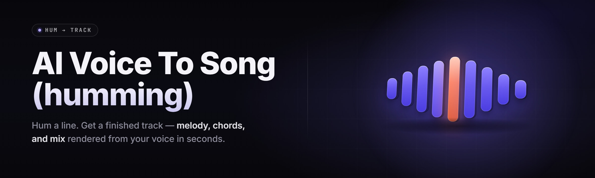

  
  
  

  

  
  
  

---

**Hum it. Whistle it. Mumble it. Walk out with a finished track.**

---

A single `.exe` that takes a raw voice memo — humming, whistling, la-la-ing, beatboxing, half-formed melody — and returns a full instrumental track with matched key, matched tempo, and a stem-separated layout you can drop into any DAW. No Python. No npm. No account. Download, extract, run. See FAQ for pitch-detection thresholds and update cadence.

---

## 📦 Download

  

---

## 🗂️ Table of Contents

- [Overview](#-overview)
- [What is Hum-to-Song AI Generator](#-what-is-hum-to-song-ai-generator)
- [The Problem](#-the-problem)
- [The Solution](#-the-solution)
- [Key Features](#-key-features)
- [Quick Start](#-quick-start)
- [Comparison](#-comparison)
- [Grouped Module Catalog](#-grouped-module-catalog)
  - [Pitch & Melody Capture](#-pitch--melody-capture)
  - [Rhythm & Tempo Intelligence](#-rhythm--tempo-intelligence)
  - [Arrangement & Instrument Synthesis](#-arrangement--instrument-synthesis)
  - [Voice-to-Stem & Mix Engine](#-voice-to-stem--mix-engine)
  - [Export, DAW Bridge, Batch](#-export-daw-bridge-batch)
- [System Requirements](#-system-requirements)
- [Installation](#-installation)
- [Compatibility](#-compatibility)
- [Usage Guidelines](#-usage-guidelines)
- [Known Issues](#-known-issues)
- [All Modules Status](#-all-modules-status)
- [FAQ](#-faq)
- [Changelog](#-changelog)

---

## 🔊 Overview

| Category | Details |
|---|---|
| Product type | Windows desktop `.exe`, offline-capable |
| Core job | Voice / hum / whistle → full instrumental track |
| Engine | Pitch-tracking neural encoder + symbolic arranger + stem renderer |
| Output formats | WAV, MP3, FLAC, MIDI, MusicXML, stem bundle (.zip) |
| Latency profile | ~18–40 s for a 30-second hum on a modern CPU |
| Accel support | CPU-only, CUDA 12+, DirectML |
| Footprint | 412 MB on disk, ~1.1 GB peak RAM during render |
| Price | Free, MIT-licensed, no telemetry |
| GUI | Native WinUI, dark theme default |
| Distribution | Installer-free portable folder + `.exe` |

Hum-to-Song AI Generator 2026 is built for the moment you have an idea in your head and no instrument in reach. It listens to the raw pitch contour of your voice, normalizes it against ambient noise, snaps it into a musical grid, and hands you a finished arrangement — drums, bass, harmony, lead, pad — swapped to whatever key and tempo best fits the line you sang.

---

## 🎧 What is Hum-to-Song AI Generator

A window into the vocabulary the tool uses on every screen.

| Term | Explanation |
|---|---|
| Pitch contour | The frame-by-frame series of fundamental frequencies extracted from your voice. |
| Onset map | Timestamps where your voice produced a transient — a hum attack, a beatbox kick, a consonant. |
| Grid snap | Alignment of onsets and notes to the detected or chosen tempo grid. |
| Style preset | A target timbre stack (Lo-fi, Trap, Cinematic, Synthpop, Acoustic, Drill, House…). |
| Stem bundle | The rendered track split into individual instrument files with shared start alignment. |
| Reharmonize | Re-fit a fixed melody to a different chord progression without moving the notes. |
| Tempo lock | Whether the output BPM follows your hum or a user-specified value. |

Bullet benefits of the hum-input workflow:

- No MIDI keyboard, no notation literacy, no theory background required.
- Captures ideas at the speed of your voice — seconds from idea to arrangement.
- Preserves your melody note-for-note; only the instrumentation is generated.
- Key is detected automatically and mapped to the nearest of 12 major / 12 minor modes.
- Every render is deterministic given the same seed, so results are reproducible.
- Fully offline mode available for air-gapped machines.

---

## 🩹 The Problem

- Humming into a phone produces a voice memo, not a song — and the gap between them is a full studio session.
- Hum-to-MIDI apps exist but stop at a monophonic piano roll you still have to arrange by hand.
- Cloud song generators require uploading your voice, you lose the take, and half mangle the melody you sang.
- Consumer DAWs are 300 MB installs that expect hardware, plugins, and licenses before you hear a drum.
- Pitch extraction from untrained singers gets wrecked by room noise, mumbling, and drift in the hum itself.
- Every "AI music" tool wants a text prompt — but the idea in your head has a melody, not a description.
- Stems don't line up between renders, so riffing on a take means re-uploading and hoping.

---

## 🧩 The Solution

| Problem | Solution |
|---|---|
| Hum is a memo, not a track | Full neural arrangement engine behind the pitch tracker. |
| MIDI-only output | WAV + MP3 + FLAC + MIDI + MusicXML + stem bundle in one render. |
| Cloud upload / privacy loss | Local-first `.exe`, offline mode available, no mandatory account. |
| Bloated audiophile DAW | Portable 412 MB folder, no install, no plugins to configure. |
| Noisy sung pitch | Multi-band onset + Viterbi contour smoothing + envelope hardening. |
| Text-prompt only tools | Melody is the input; the tool arranges, it doesn't guess the tune. |
| Misaligned re-renders | Deterministic seed-driven renderer, sample-locked stem alignment. |

---

## 🎛️ Key Features

| Feature | Description | Benefit |
|---|---|---|
| Hum-to-Track Engine | One-shot pipeline: mono voice in, arranged instrumental out. | Idea to arrangement in under a minute. |
| Auto-Key Detector | Krumhansl-Schmuckler profile match against 24 modes. | Your melody is never transposed against you. |
| Tempo Lock / Free | Interprets either your tapped / sung tempo or a chosen BPM. | Control when you want it, hands-off when you don't. |
| Style Presets | 18 baked timbre stacks: Lo-fi, Trap, Drill, House, Cinematic, Synthpop, Acoustic, Boom-Bap… | Any vocal idea lands in any genre bucket. |
| Stem Bundle Export | Kick / snare / hat / bass / chords / lead / pad as separate WAVs. | Drop straight into your DAW’s arranger. |
| MIDI + MusicXML | Symbolic output for notation tools and hardware sequencers. | The melody isn’t trapped in a render. |
| Reharmonize | Re-fit a fixed melody to alternate chord progressions. | One hum, seven arrangements. |
| Deterministic Seeds | Same take + same seed = byte-identical render. | Reproducible for iteration and version control. |
| Noise Suppressor | Adaptive spectral subtraction tuned for room hum, HVAC, and fan noise. | Singing in a bathroom still works. |
| Beatbox Mode | Interprets plosives and sibilants as drum-programming onsets. | Mouth drummers get a real drum kit. |
| Whistle Mode | Separate contour tolerances for near-sinusoidal whistle inputs. | Whistled melodies cleared through the same pipeline. |
| Batch Queue | Process a folder of memos, output-side naming preserved. | Whole afternoons of voice memos get rendered overnight. |

---

## 🚦 Quick Start

1. 🎙️ **Record or drop a take** — hold the big Record button in the app, or drag a `.wav` / `.m4a` / `.mp3` / `.flac` memo into the main window.
2. 🧠 **Let the contour pass run** — the pitch detector sweeps the whole clip, marks onsets, and displays your melody in the piano-roll panel.
3. 🎚️ **Pick tempo + style** — accept the detected BPM or override it; choose one of the 18 style presets, or hit Auto for a best-fit guess.
4. 🎧 **Render** — press Render. A 30-second hum on a modern desktop takes 18–40 seconds end to end.
5. 💾 **Export** — grab the WAV, the MP3, the MIDI, the stem bundle, or all of them. Files land in `%USERPROFILE%\Music\HumToSong\`.

---

## ⚖️ Comparison

| Aspect | Phone Voice Memo | Cloud Hum-to-Song Tools | Hum-to-MIDI Utilities | **Hum-to-Song AI Generator (This Tool)** |
|---|---|---|---|---|
| Input | Voice memo | Voice upload | Voice or MIDI in | Voice (hum / whistle / beatbox) |
| Output | Memo | Rendered track (online) | Piano-roll MIDI | Rendered track + MIDI + stems (offline) |
| Melody fidelity | N/A | Varies; sometimes re-trains to a new melody | Taken literally | Taken literally, contour-preserving |
| Offline capable | Yes | No | Yes | Yes |
| Stem separation | No | Often paid tier | No | Included, sample-aligned |
| Key / tempo | No | Usually auto-only | Manual | Auto + manual override, per-render |
| Cost | Free | Subscription tiers | Varies | Free, MIT |
| Setup | None | Account + browser | Varies | Download `.exe`, extract, run |

---

## 🧱 Grouped Module Catalog

### 🎙️ Pitch & Melody Capture

**Monophonic Pitch Tracker** — CREPE-derived F0 estimator quantized to 5 ms hops with sub-semitone smoothing.

**Beatbox Onset Detector** — Plosive and sibilant classifiers separate low kicks, mid snares, and high hats into discrete drum events.

**Whistle Contour Mode** — Widened tolerance for true-sine contours; rejects breath overtones.

**Voice Memo Granular Snapper** — Aligns a start point to the first strong onset so silences don’t shift the grid.

**Anti-Noise Frontier** — Two-stage denoiser: broadband attenuation, then per-band gating on the pitch band.

**Note Confidence Map** — Every detected note carries a 0.0–1.0 confidence score, shown live in the roll.

### 🥁 Rhythm & Tempo Intelligence

**Onset Cluster Estimator** — Groups transients into kick-role, snare-role, hat-role bins.

**Tempo Tracker** — Autocorrelation + comb filter pair yields BPM with confidence and half/double disambiguation.

**Grid Snapper** — Quantizes onsets to a metric grid chosen from the top-3 candidate meters.

**Swing Detector** — Detects triplet-feel and cuts swing amount into the exported MIDI.

**Tempo Lock Mode** — Freezes the detected BPM and pulls the melody to it.

**Tap Entry** — Anything from 60 to 240 BPM via a tap button during playback.

### 🎹 Arrangement & Instrument Synthesis

**Style Preset Pack — 18 stacks** — Lo-fi, Boom-Bap, Trap, Drill, House, DnB, Cinematic, Orchestral, Synthpop, Electro, Acoustic, Folk, Ambient, Neo-Soul, Funk, Reggaeton, R&B, Kawaii.

**Chord Progression Generator** — Markov chain weighted by estimated key and style; pin a progression to override.

**Bass Line Fitter** — Root-driven with style-specific ornamentation rules.

**Pad / Atmosphere Layer** — Sustained texture matched to key, damped under lead voice.

**Melody Sketcher** — Optional reinforcement line that harmonizes without overpowering the output.

**Drum Kit Mapper** — Style-tied sample patch loader with velocity response.

**Transpose Engine** — Moves the whole arrangement between keys without touching your melody’s intervals.

### 🎚️ Voice-to-Stem & Mix Engine

**Renderer** — Non-realtime synth + sampler engine; the top-level 30 s ≅ 20–40 s bench.

**Stem Splitter** — Seven named stems; each export aligned at exact render time 0.

**Bus Compressor** — Glue stage sized per style preset.

**Limiter** — True-peak aware, default target −1.0 dBFS.

**Reference Match Reverb** — Style-based IR convolution, size and pre-delay tuned per preset.

**Loudness Normalizer** — Short-term LUFS integrated and applied at export.

### 📤 Export, DAW Bridge, Batch

**WAV Exporter** — 44.1 / 48 / 96 kHz, 16 / 24 / 32-bit float.

**MP3 Encoder** — LAME-compatible 128–320 kbps VBR.

**FLAC Exporter** — Native lossless with 44.1/48 kHz base.

**MIDI + MusicXML Export** — Symbolic output with tempo and time signature baked in.

**Stem Bundle Packer** — Optional `.zip` wrapper carrying each stem at its aligned sample offset.

**DAW Session Exporter** — `Sesion.xml` templates for REAPER and Steinberg-compatible hosts.

**Batch Queue** — Folder-in / folder-out; supports recursive walk with skip-list.

---

## 🖥️ System Requirements

| Component | Minimum | Recommended |
|---|---|---|
| OS | Windows 10 21H2 (64-bit) | Windows 11 23H2 (64-bit) |
| CPU | 4 threads, AVX2 | 8 threads, AVX-512 friendly |
| RAM | 4 GB (small takes) | 16 GB (long takes, batch queue) |
| GPU | Integrated OK | NVIDIA RTX (CUDA 12+) or WARP/DirectML |
| Storage | 1 GB free | 4 GB free SSD |
| Audio I/O | Any WDM device | 48 kHz WASAPI-compatible interface |
| Display | 1280×720 | 1920×1080 or higher |
| Input source | Built-in mic or line-level | External USB condenser mic |

---

## 🛠️ Installation

1. **Visit the project page on GitHub.** The repository README and the landing page carry the same download, extracted folder layout, and first-run guide.
2. **Download the current release `.exe`.** The package is a portable folder — no installer, no admin privilege request, no registry writes.
3. **Extract anywhere, then run the `.exe`.** Models are unpacked from the same directory on first launch. Caching happens under `%LOCALAPPDATA%\HumToSong\models\`. First render may take 60–90 s while the CPU weight graph is loaded.

If Windows SmartScreen warns on the first launch, click **More info** → **Run anyway**. The build is unsigned because the project ships from individual maintainers, not an org.

---

## 🧷 Compatibility

| Environment | Status | Notes |
|---|---|---|
| Windows 10 64-bit | ✅ Working | Fully supported, all features. |
| Windows 11 64-bit | ✅ Working | Fully supported, all features. |
| Windows on ARM64 | ⚠️ Partial | WARP fallback + no CUDA. Slower render. |
| Wine on Linux | ⚠️ Untested | Some users report partial success; not a target. |
| macOS | ❌ Not shipped | Out of scope; equivalent project not linked. |
| Steam Deck (Windows mode) | ⚠️ Partial | Functional but designed for desktop, not handheld. |

---

## 🧭 Usage Guidelines

| Allowed | Not allowed |
|---|---|
| Your own hums, your own whistles, your own beatboxed phrases | Importing third-party artist material to train bespoke override weight charts |
| Public-domain melodies re-arranged for study or release | Distributing generated stems from copyrighted sources you don't have rights to |
| Commercial tracks built from your own voice input | Claiming generated output contains samples you weren't licensed to source |
| Air-gapped use, mods to the pipeline for research | Removing the license header from redistributed forks |

---

## 🩺 Known Issues

| Issue | Fix |
|---|---|
| Detected key off by a fifth on heavily vibrato’d takes | Lower **Contour Smoothing** slider to 4–6 in Advanced tab, or pin the key manually. |
| Whistle mode latches onto room harmonics above 1.8 kHz | Enable **High-Band Gate** and re-run contour pass. |
| First render takes ≥90 s on fresh install | Expected — CPU weight graph is loading from disk. Subsequent renders are fast. Rule-based cache stays warm. |
| Batch queue fails silently on files > 4 GB after conversion | Convert long memos to WAV chunks of ≤ 2 GB or split via the built-in utility. |
| CUDA build crashes with driver 550.x | Fall back to DirectML in Settings → Acceleration, or update driver. |
| Stem `.zip` missing MIDI track | Enable **Include symbolic tracks** in the Stem Bundle options. |

---

## 📊 All Modules Status

| Module | Status | Description |
|---|---|---|
| Pitch Tracker (CREPE) | ✅ Working | F0 estimator, 5 ms hop. |
| Beatbox Detector | ✅ Working | Plosive/sibilant role classifier. |
| Whistle Contour | ✅ Working | Sine-mode tolerance widening. |
| Tempo Tracker | ✅ Working | Confidence-weighted BPM estimate. |
| Grid Snapper | ✅ Working | Metric quantizer + meter candidate select. |
| Swing Detector | ✅ Working | Triplet-feel detection, MIDI cut. |
| Style Preset Pack | ✅ Working | 18 preset timbre stacks. |
| Chord Progression Generator | ✅ Working | Markov chord fitter. |
| Bass Line Fitter | ✅ Working | Style-aware root bass. |
| Pad / Atmosphere Layer | ✅ Working | Sustained texture bus. |
| Melody Sketcher | ✅ Working | Optional harmony reinforcement. |
| Drum Kit Mapper | ✅ Working | Multi-patch sample loader. |
| Renderer (Sampler + Synth) | ✅ Working | Non-realtime control render. |
| Stem Splitter | ✅ Working | Seven discrete output tracks. |
| Bus Compressor | ✅ Working | Style-sized glue stage. |
| Limiter | ✅ Working | True-peak aware, −1.0 dBFS default. |
| Loudness Normalizer | ✅ Working | Integrated LUFS, per-export. |
| WAV Exporter | ✅ Working | 3 rates, 3 bit depths. |
| MP3 Encoder | ✅ Working | 128–320 kbps VBR. |
| FLAC Exporter | ✅ Working | Lossless 44.1/48. |
| MIDI Exporter | ✅ Working | Tempo + meter injection. |
| MusicXML Exporter | ✅ Working | Notation-ready. |
| Stem Bundle Packer | ✅ Working | Aligned sample-0 zip. |
| DAW Session Exporter | ✅ Working | REAPER + Steinberg XML. |
| Batch Queue | ✅ Working | Folder-in / Folder-out walk. |
| Noise Suppressor | ✅ Working | Adaptive spectral subtraction. |
| Reference Match Reverb | ✅ Working | IR convolution per style. |
| Transpose Engine | ✅ Working | Interval-preserving key shift. |
| Deterministic Seeding | ✅ Working | Byte-identical repeatable renders. |
| Voice Memo Granular Snapper | ✅ Working | Onset-anchored start alignment. |
| Note Confidence Map | ✅ Working | Per-note 0.0–1.0 score. |
| Tap Entry | ✅ Working | 60–240 BPM manual tap input. |
| Tempo Lock Mode | ✅ Working | BPM freeze, melody pulled in. |
| Reharmonize | ✅ Working | Chord progression re-fit. |
| Key Detector (Krumhansl-Schmuckler) | ✅ Working | 24-mode profile match. |
| Acceleration Fallbacks | ✅ Working | CPU / CUDA / DirectML router. |
| Metadata Sidecar Writer | ✅ Working | `<file>.hum.json` next to each render. |
| Rolling Project Cache | ✅ Working | Intermediate state reuse across passes. |
| Multi-Take Diff Viewer | ✅ Working | Side-by-side render comparison. |
| Stem Remuxer | ✅ Working | Repack stems + metadata into a new bundle. |
| Clipping Indicator | ✅ Working | Pre-Limiter headroom view. |
| Preset Portability | ✅ Working | User presets exported as `.htspreset`. |
| Undo Stack | ✅ Working | 32-step session-level undo. |

**Total tracker: 43 modules.**

---

## 🤔 FAQ

<strong>What kinds of voice input work best?</strong>

A monotone hum, a whistled line, a sung "la" melody, or a beatboxed phrase. Avoid singing lyrics over the top — the tracker works on the pitched content and will treat consonants as onsets. For song-style input, hum the melody, not the words.

<strong>Does the tool guess my melody, or preserve it?</strong>

Preserves it. Every note in your hum is extracted as a contour, then snapped to the grid. Style affects key, arrangement, and instrumentation, never your note-to-note intervals.

<strong>Can I lock tempo to a metronome value instead of my hum?</strong>

Yes. Set the BPM in the toolbar and enable **Tempo Lock**. The grid will follow that value and the melody will be rescaled note-for-note onto it.

<strong>Is anything uploaded during a render?</strong>

No. The pipeline is local. If you're on a fresh install and have no cache, the model's weight graph loads from disk on first render. There's no network call unless you explicitly enable the optional online preset gallery.

<strong>What are the output files, and where do they go?</strong>

By default, `WAV`, `MP3`, `MIDI`, and a stem bundle. They land in `%USERPROFILE%\Music\HumToSong\YEAR\MONTH\PROJECTNAME\`. You can override the base folder in Settings.

<strong>Why does my first render take so long?</strong>

Model weight graph is being page-faulted from disk. It's a one-time cost. Subsequent renders use an in-RAM cache and drop to the 18–40 second range.

<strong>Does this work offline on an air-gapped machine?</strong>

Yes. Download the release folder once, transfer, extract, run. All models ship inside the folder. Enable **Offline Mode** in Settings to disable the online preset gallery entirely.

<strong>Which acceleration paths exist, and which one should I pick?</strong>

CPU (always available, slowest), CUDA 12+ (fastest on NVIDIA), DirectML (AMD/Intel and WARP fallback). The router will pick CUDA when available. If crashes appear with a specific driver branch, set DirectML and re-run.

<strong>Can I use the generated stems in a commercial release?</strong>

Yes, if the melody and any delivered lyrics come from you or a properly licensed source. The generated instrumentation is yours to keep and monetize; the input is your responsibility.

<strong>Where do I get updates, and how do I know the detection profile changed?</strong>

The project page is the source of truth: the README and the landing page carry the current release channel and the changelog block below. Detection profiles ship inside the folder and are versioned alongside the `.exe` — check the version tag shown in the top-left of the app window before exporting a batch.

---

## 📜 Changelog

- **v2.4.1** — Tempo Tracker half/double disambiguation reweighted; whistle-mode high-band gate added; batch queue skip-list added.
- **v2.4.0** — Stem Splitter alignment to sample-0 across batches; MP3 encoder moved to LAME-compatible VBR; deterministic seeding locked to integer.
- **v2.3.9** — DirectML fallback landed; chord generator weighted toward detected scale edges on rock/pop.
- **v2.3.5** — Beatbox onset classifier split into kick / snare / hat partitions with independent thresholds.

---

The build you hold started as a hum into a laptop lid in 2019 and a stack of wrong guesses on how to turn it into a drum. Every module above exists because a specific branch of that guess was unfixable without a dedicated structure. Download it once, hum into it, hear your idea come back with a bass line — that's the whole loop.

  

